# Songdo Edge Intelligence (송도 엣지 인텔리전스)
## Inha University — Operating System (운영체제), Prof. Mehdi Pirahandeh
**Team A**: Aidar, Arkar (OS1) · Umid, Umrbek (OS2) · Arlen, Onill (OS3) · Nazarbek (OS4) · Umidillo (OS5)

**Platform**: Ubuntu 24.04 LTS | Python 3.12 | SQLite 3 (WAL mode)<br>
**Mission**: *"Make Songdo compute locally and reliably."*<br>
**Signature demonstration**: **"Disconnect Internet → system continues operating."**

A multi-process Linux edge node that keeps sensing, deciding and actuating when the WAN is cut, then
drains its durable outbox with zero lost events. Five themes (OS1–OS5) × 5 scenarios = **25 scenarios**,
all on one shared core. Python standard library plus `pyyaml` (and `psutil`, used only as a fallback
outside Linux).

**At a glance (all on one team machine, see [Results](#results)):** 25/25 scenarios pass · 87/87 unit
tests pass · four 10-minute WAN outages with **zero lost and zero duplicated events** · the robot stopped
for **162/162** obstacles while offline · the live dashboard keeps *Conserved: yes* through a cut and restore.

---

## Contents
1. [Quickstart](#quickstart-the-course-readmes-five-steps)
2. [How it works](#how-it-works)
3. [Teams and their 25 scenarios](#teams-and-their-25-scenarios)
4. [What each scenario demonstrates](#what-each-scenario-demonstrates)
5. [Results (screenshots)](#results)
6. [File layout](#file-layout-as-in-the-course-readme)
7. [Operations: systemd, backup, container](#operations)
8. [Requirement map](#requirement-map-handbook-rubric--where-it-is)
9. [Known gaps](#known-gaps-be-honest-about-them-in-the-defense)

---

## Quickstart (the course README's five steps)

Run from the repository root (`cd songdo-edge-intelligence`). On Ubuntu, `python` is `python3`.

```bash
# Step 1: preflight audit (kernel, shell, Python, SQLite, ps/pkill/awk/sed/flock/curl)
bash scripts/preflight.sh

# Step 2: virtual environment + dependencies (psutil, pyyaml) + database data/songdo_edge.db in WAL mode
bash scripts/setup.sh

# Step 3: automated OS concurrency suite (WAL + atomic outbox, bounded queue, race + mutex,
#         deadlock timeout recovery, online backup integrity)
python3 tests/test_os_fundamentals.py

# Step 4: all 25 scenarios (about 2 minutes); --theme os2 for one theme, --only s5 for one scenario number
python3 scenarios/run_all_scenarios.py

# Step 5: signature offline demo + local web console
bash scripts/start_demo.sh OS1         # dashboard: http://127.0.0.1:8001 (the port is printed on start)
```

In the dashboard: live PIDs, CPU %, RSS memory and ingested events. **Simulate WAN Internet Cut** →
the badge shows OFFLINE, events and local decisions continue, *Outbox queued* grows.
**Restore WAN Connection** → the backlog drains, *Conserved* stays `yes`. Stop with **Ctrl+C**.

Ports: `start_demo.sh` with no theme (config/node.yaml) and the Docker image use **8000**; the
theme nodes use **8001–8005** (OS1–OS5) so all five can run at the same time without colliding.

More tests: `PYTHONPATH=src python3 -m unittest discover -s tests -v` (all unit + scenario tests),
`python3 integration/test_mock_upstream.py` (outbox → HTTP → mock upstream across a WAN cut).

**The signature 10-minute WAN outage** (one per theme that has it; run one at a time on an idle machine):
```bash
mkdir -p results
PYTHONPATH=src .venv/bin/python -m edge.teams.os1_building.s5_wan_outage --outage 600 | tee results/os1_s5_offline_600s.txt
PYTHONPATH=src .venv/bin/python -m edge.teams.os2_robot.s5_offline_navigation --offline 600 --track results/os2_s5_track_600s.csv | tee results/os2_s5_offline_600s.txt
PYTHONPATH=src .venv/bin/python -m edge.teams.os3_mobility.s5_speed_sign_replay --duration 600 | tee results/os3_s5_offline_600s.txt
PYTHONPATH=src .venv/bin/python -m edge.teams.os5_reliable.s5_compound_failure --cut 600 | tee results/os5_s5_offline_600s.txt
```

---

## How it works

```
SensorGen --(BoundedQueue 500, drop_oldest)--> Processor --> SQLite WAL (events + outbox in ONE transaction)
HealthMon (/proc -> process_health)                 |        decisions with monotonic TTL -> actuator
API (http.server dashboard, /api/status, /api/wan/*)    SyncWorker (drains the outbox only while WAN is online)
Supervisor starts, monitors (SIGCHLD / wait), restarts and cleanly stops every process.
```

- **Separate Linux processes.** `SensorGen`, `Processor`, `HealthMon`, `SyncWorker` and `API` each run
  in their own process with their own PID and address space, started by the `Supervisor`. A crash in one
  cannot corrupt another's memory, and the supervisor restarts a dead worker (SIGCHLD + `wait()`, so no zombies).
- **Bounded IPC.** Sensor readings travel through a queue capped at 500 items. When the consumer is slow,
  the *oldest* reading is dropped, so memory (RSS) stays bounded and the newest data is always kept.
- **Durable first, network second.** Every reading is written to SQLite (WAL mode) together with an
  outbox row in one transaction: either both exist or neither. Local decisions never wait for the network.
- **Commands expire.** Each actuator command carries an expiry time on the monotonic clock
  (`issued + TTL`), so a command that arrives late is rejected instead of acting on old information.
- **Offline, then drain.** While the WAN flag is off, the outbox only grows. When it is back, the
  `SyncWorker` drains it in batches; the receiver deduplicates by `event_id`, so a resend is never stored
  twice. The *conservation* check (`events = delivered + pending`) proves nothing was lost.
- **Observable.** `HealthMon` samples `/proc/<pid>/stat` and `/proc/<pid>/status` (CPU, RSS, context
  switches) into `process_health`; the zero-dependency dashboard reads it through `/api/status`.

---

## Teams and their 25 scenarios

| Group | Theme | Folder | Config | Port | Members | Scenarios (one file each) |
|---|---|---|---|---|---|---|
| OS1 | OS1 Smart Building Edge Gateway | `src/edge/teams/os1_building/` | `config/os1.yaml` | 8001 | Aidar, Arkar | OS1-1 Local Room Sensor Ingestion & Cached Inventory<br>OS1-2 Competing Occupancy Writers & Race Condition Demonstration<br>OS1-3 Local Ventilation Rule & Damper Actuator Dispatch<br>OS1-4 Contention Profiling & Resource Sampling<br>OS1-5 Signature WAN Outage & Offline Outbox Queueing |
| OS2 | OS2 Robot Edge Controller | `src/edge/teams/os2_robot/` | `config/os2.yaml` | 8002 | Umid, Umrbek | OS2-1 Multi-Process Robot Architecture & IPC Topology<br>OS2-2 Periodic Monotonic Deadlines & Jitter Measurement<br>OS2-3 Obstacle Proximity E-Stop & Actuator Command Expiry<br>OS2-4 Worker Crash & Supervised Automatic Restart<br>OS2-5 Autonomous Offline Pathway Navigation |
| OS3 | OS3 Autonomous Mobility Edge Node | `src/edge/teams/os3_mobility/` | `config/os3.yaml` | 8003 | Arlen, Onill | OS3-1 Incheon Bus Stop Context & Vehicle Influx Stream<br>OS3-2 Priority-Aware Bounded Queue Processing<br>OS3-3 Overload Experiment & Drop Policy Verification<br>OS3-4 Transactional State Update & Version Guarding<br>OS3-5 Offline Variable Speed Sign Dispatch & Event Replay |
| OS4 | OS4 IoT Edge Gateway | `src/edge/teams/os4_iot/` | `config/os4.yaml` | 8004 | Nazarbek | OS4-1 Heterogeneous Multi-Stream Sensor Ingestion<br>OS4-2 Event-Time vs. Receipt-Time Handling<br>OS4-3 Dust Suppression Mist Cannon Relay Actuation<br>OS4-4 Scheduled Database Backup via systemd Timer / Cron<br>OS4-5 WAN Outage Backlog Drain & AirKorea Baseline Benchmark |
| OS5 | OS5 Fault-Tolerant Smart-City Node | `src/edge/teams/os5_reliable/` | `config/os5.yaml` | 8005 | Umidillo | OS5-1 Health Check Architecture & Readiness State Machine<br>OS5-2 Disposable Worker Kill & Preserved State Recovery<br>OS5-3 Deadlock Detection & Mutex Timeout Recovery<br>OS5-4 Disaster Flood Relief Sluice Gate Actuation<br>OS5-5 Compound Failure Survivability (WAN Cut + Worker Crash) |

Each scenario also runs alone: `PYTHONPATH=src python3 -m edge.teams.<theme_folder>.<scenario>`
(for example `PYTHONPATH=src python3 -m edge.teams.os2_robot.s3_estop_ttl`).

---

## What each scenario demonstrates

Each scenario is a small program that sets up a situation, measures what happens and checks the
result. It prints `[PASS]` only when every check holds; every check line starts with `ok` or `FAILED`.

### OS1 — Smart Building Edge Gateway (Songdo Convensia) · Aidar, Arkar
| Scenario | What it shows | OS concept |
|---|---|---|
| OS1-1 Sensor ingestion & cached inventory | Indoor CO₂/temperature readings are stored and mapped to the building they belong to, using cached building footprints (point-in-polygon). | File descriptors, cached reference data, atomic event + outbox write |
| OS1-2 Race condition demonstration | 80 concurrent increments: without a lock updates are lost (result < 80), with a Mutex the result is exactly 80. Shown with threads and with real processes. | LOAD/ADD/STORE race, critical section, `Lock` |
| OS1-3 Ventilation rule & damper dispatch | CO₂ > 1000 ppm sets the damper to 100 %; the command expires after 15 s on the monotonic clock. | Monotonic clock, command TTL |
| OS1-4 Contention profiling | Samples RSS memory and context switches of processes under synthetic load and records them. | `/proc/<pid>/stat`, voluntary vs. involuntary context switches |
| OS1-5 Signature WAN outage | The WAN is cut: readings queue in the outbox, the ventilation rule keeps firing, then the backlog drains with no loss and no duplicates. | Durable outbox, idempotent drain |

### OS2 — Robot Edge Controller (Songdo Central Park) · Umid, Umrbek
| Scenario | What it shows | OS concept |
|---|---|---|
| OS2-1 Multi-process robot architecture | LiDAR, Controller and SafetyMonitor run as 3 separate processes. The Controller has a deliberate bug (wrong MOVE commands); the SafetyMonitor vetoes every one over a Unix socket. Clean shutdown, no zombies. | Process isolation, bounded queue + Unix domain socket IPC |
| OS2-2 Periodic deadlines & jitter | A 50 ms control loop: `work(); sleep(T)` drifts by ~300 ms in 3 s, a loop on absolute monotonic deadlines does not drift, even with 2 CPU-burning processes competing. Jitter J[n] = \|Δt[n] − T\|. | Scheduler (CFS/EEVDF), monotonic clock, drift vs. jitter |
| OS2-3 Obstacle e-stop & command expiry | LiDAR < 0.8 m latches the emergency stop straight from the sensor (0.80 does not, 0.79 does); commands older than 500 ms are rejected; release needs 1.0 m (hysteresis). | Fail-safe design, monotonic TTL |
| OS2-4 Worker crash & supervised restart | The motion worker is killed with SIGKILL; the supervisor traps SIGCHLD, reaps it with `wait()` and restarts it in ~0.1–0.2 s (limit 2 s); the new worker resumes from the state saved in SQLite. | Signals, SIGCHLD, zombies, durable state |
| OS2-5 Autonomous offline navigation | The robot drives along a Central Park path while the WAN is cut, stops for every pedestrian/dog closer than 0.8 m (not for cyclists passing at a safe distance), and delivers every LiDAR + IMU event after the WAN returns. | Local control without the network, durable outbox, conservation |

### OS3 — Autonomous Mobility Edge Node (Techno-Park intersection) · Arlen, Onill
| Scenario | What it shows | OS concept |
|---|---|---|
| OS3-1 Bus stop context & vehicle stream | Loads the real Incheon BIS bus stop/route data for the Techno-Park area as read-only context and stores a live vehicle/pedestrian stream. | Reference data vs. live stream, atomic writes |
| OS3-2 Priority-aware bounded queue | Pedestrian surge alarms are processed before background logging. | Bounded priority queue, latency |
| OS3-3 Overload & drop policy | The node is flooded faster than it can process; the queue stays capped at 500, the oldest items are dropped, nothing crashes and memory stays bounded. | Backpressure, drop_oldest, OOM avoidance |
| OS3-4 Transactional state & version guard | Several processes update the same speed-sign state; a version column + compare-and-swap inside a transaction makes the loser retry, so no update is lost. | ACID transactions, optimistic concurrency |
| OS3-5 Offline speed sign & event replay | During a WAN cut and a pedestrian surge the sign is set to 30 km/h locally, reverts after its TTL, and every stored event is replayed when the WAN returns; deliberate resends are ignored. | Local decisions, TTL, replay + dedup |

### OS4 — IoT Edge Gateway (Techno-Strip Tower) · Nazarbek
| Scenario | What it shows | OS concept |
|---|---|---|
| OS4-1 Multi-stream ingestion | PM2.5, noise and illumination sensors (separate processes) write to pipes at different rates; one loop multiplexes them with `selectors` (epoll) and non-blocking reads. | Non-blocking I/O, polling, partial frames |
| OS4-2 Event time vs. receipt time | Delayed readings arrive out of order; aggregating by event time (with a watermark) gives the right answer, by receipt time does not. | Two clocks per event, late data |
| OS4-3 Mist cannon relay | PM2.5 > 50 µg/m³ (Korea "Bad") switches the mist cannon on with a 30 s TTL; the TTL works as a lease, so the relay turns itself off when commands stop. | Strict threshold, monotonic TTL, fail-safe lease |
| OS4-4 Scheduled database backup | Online SQLite backup while writers keep writing, `PRAGMA integrity_check`, retention, and `flock -n` so overlapping runs exit instead of piling up. | SQLite backup API, `flock`, systemd timer / cron |
| OS4-5 Backlog drain & AirKorea benchmark | 6 simulated hours with a 3-hour WAN cut: the backlog drains with 100 % acknowledgement, a re-sent batch is answered as duplicate, and the hourly means are compared with the AirKorea baseline. | At-least-once delivery + idempotent receiver |

### OS5 — Fault-Tolerant Smart-City Node (Waterfront lake sluice) · Umidillo
| Scenario | What it shows | OS concept |
|---|---|---|
| OS5-1 Health checks & readiness | Workers send heartbeats; the prober tells *alive but not ready* (dependency down), *hung* (stale heartbeat) and *dead* (PID gone) apart. | Liveness vs. readiness probes |
| OS5-2 Worker kill & state recovery | The processor is SIGKILLed several times at random moments; it is respawned and no data is lost, because its input is a durable SQLite inbox. | Disposable workers, durable state |
| OS5-3 Deadlock detection & timeout recovery | Two processes take two locks in opposite order: blocking acquire deadlocks (detected by a watchdog), `acquire(timeout=0.2)` + back-off recovers, global lock ordering prevents it. | Circular wait, timeouts, lock ordering |
| OS5-4 Sluice gate actuation | Water level > 2.8 m opens the backup sluice gate (exactly 2.8 does not), with a monotonic TTL and hysteresis so the gate does not chatter. | Strict threshold, TTL, hysteresis |
| OS5-5 Compound failure | The WAN is cut and the processor is SIGKILLed at the same moment during a flood: the worker recovers, the gate still opens locally, and every flood event is delivered after the WAN returns. | Combined fault tolerance |

---

## Results

All screenshots below were taken by the team on **24 October 2026** from a fresh clone of `main` at
commit `9ffe45d`, on Umid's machine: **Ubuntu 26.04.1 LTS, kernel 7.0.0-38, Python 3.14.4,
SQLite 3.46.1** (screenshot 1). The handbook's target platform is Ubuntu 24.04 + Python 3.12; the
code was also run on Ubuntu 24.04: the five OS2 scenarios on Umrbek's laptop (WSL, Python 3.12), and
all 25 scenarios plus the full test suite on a second Linux machine (Python 3.13).

| Check | Command | Result |
|---|---|---|
| Machine | `lsb_release -d; uname -r; python3 --version; sqlite3 --version` | Ubuntu 26.04.1, Python 3.14.4, SQLite 3.46.1 |
| Step 1 preflight | `bash scripts/preflight.sh` | all `[ OK ]` |
| Step 3 OS fundamentals | `python3 tests/test_os_fundamentals.py` | **10/10 OK** |
| Step 4 all scenarios | `python3 scenarios/run_all_scenarios.py` | **25/25 PASS** |
| Full unit suite | `PYTHONPATH=src .venv/bin/python -m unittest discover -s tests` | **87/87 OK** |
| OS1-5, 10-min WAN cut | `--outage 600` | **PASS**, 6,040 stored = 6,040 delivered |
| OS2-5, 10-min WAN cut | `--offline 600` | **PASS**, 162/162 e-stops, 24,320 stored = 24,320 delivered |
| OS3-5, 10-min WAN cut | `--duration 600` | **PASS**, 53,361 stored = 53,361 delivered |
| OS4-5 backlog drain | (simulated 6 h) | **PASS**, 360/360 acknowledged |
| OS5-5, 10-min WAN cut + crash | `--cut 600` | **PASS**, recovered in 0.22 s, 240 = 240 delivered |
| Step 5 dashboard (OS2) | `bash scripts/start_demo.sh OS2` | cut → outbox 132 queued, restore → 0, *Conserved: yes* |

### 1. Machine and preflight
The test machine, then the preflight audit: kernel, shell, Python, SQLite and every required POSIX
tool are present.

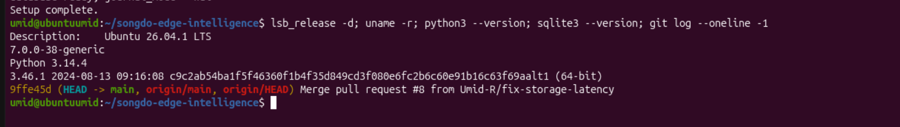
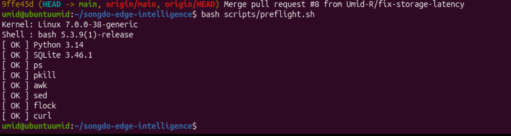

### 2. The five OS fundamentals (README Step 3)
`tests/test_os_fundamentals.py` checks, in order: SQLite WAL mode and the atomic event + outbox write,
the bounded queue (capped at 500, oldest 200 of 700 dropped), the race condition (lost updates without
a lock, exactly 80 with one), deadlock detection with `acquire(timeout=0.2)` recovery, and an online
backup that passes `PRAGMA integrity_check`. **Ran 10 tests, OK.**

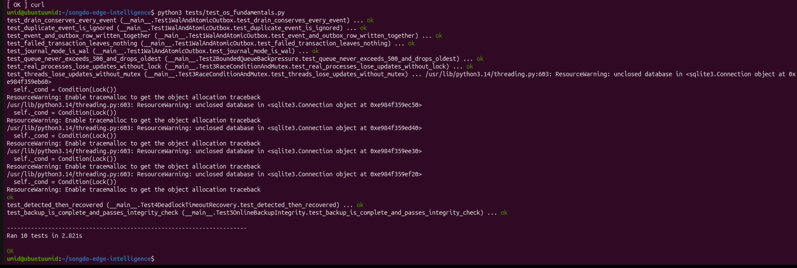

> The yellow `ResourceWarning: unclosed database` lines are printed by Python 3.14 when a test ends
> while a cached SQLite connection is still open. They do not affect any result (every test says `ok`).

### 3. All 25 scenarios (README Step 4)
Every scenario of every theme runs as its own process; the runner counts a scenario as PASS only if
it exits with code 0. **25/25 scenarios passed** in about 1.5 minutes.

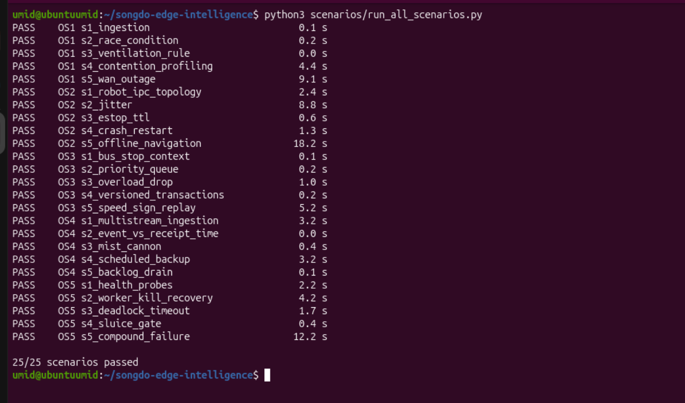

### 4. Full unit test suite
All shared-core tests, config tests, pipeline tests and the per-scenario tests of all five themes:
**Ran 87 tests, OK** (same harmless `ResourceWarning` lines as above). The two `REJECT stale command`
lines are expected: those tests send an expired command on purpose to prove it is rejected.

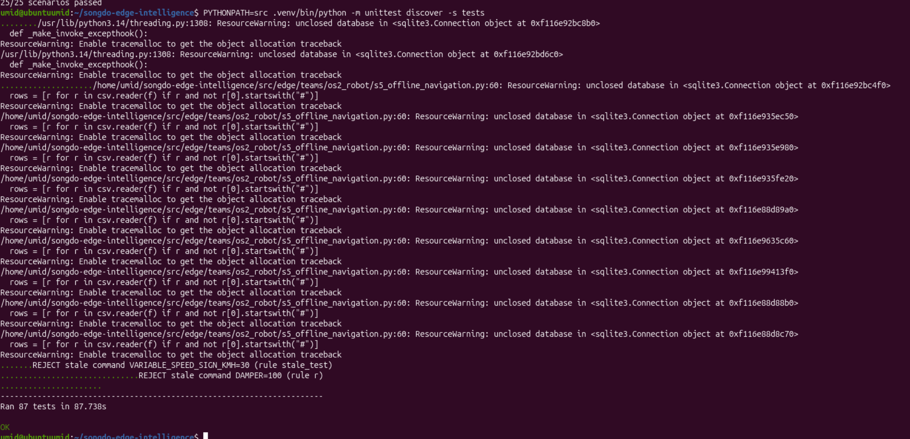

### 5. The signature demo: 10-minute WAN outages
Each run keeps the (mock) WAN disconnected for **600 seconds** of real time while the node keeps
working, then restores it and checks event conservation. Runs were made one at a time on an idle machine.

| Run | During the 10-minute cut | After the WAN returns |
|---|---|---|
| **OS1-5** building | 6,000 readings kept arriving (longest gap 178 ms, limit 600 ms); the ventilation rule fired for all 900 high-CO₂ readings; outbox 12 → 6,001; nothing delivered | outbox drained to 0; **6,040 stored = 6,040 delivered, 6,040 distinct** |
| **OS2-5** robot | 12,000 control ticks, longest gap **89 ms** (limit 300 ms); **162/162** pedestrians/dogs closer than 0.8 m stopped the robot, **0** false stops for 49 cyclists; drove 253 m; outbox 26 → 24,004; nothing delivered | outbox drained to 0; **24,320 LiDAR + IMU events stored = 24,320 delivered, 24,320 distinct** |
| **OS3-5** mobility | 8,845 local decisions; speed sign set to 30 km/h and reverted to 50 after its TTL; outbox 21 → 53,291; upstream got 0 events | **53,361 generated = stored = delivered**; 5 deliberate resends ignored as duplicates; expired command rejected |
| **OS5-5** sluice | WAN cut and processor SIGKILL 1 ms apart; worker back in **0.22 s** (limit 2 s); flood gate opened locally 0.10 s after the first flood reading; the 240 flood readings arrive in the first ~12 s and a backlog of 143 is held for the rest of the cut | outbox drained to 0; **240 stored = 240 delivered = 240 produced**; gate opened during the flood and closed after; no zombies |

**OS1-5** — building gateway, 10-minute outage:

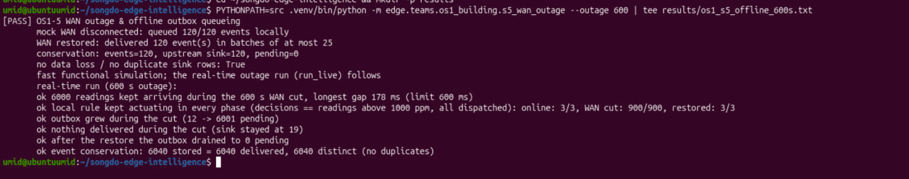

**OS2-5** — robot navigating offline for 10 minutes:

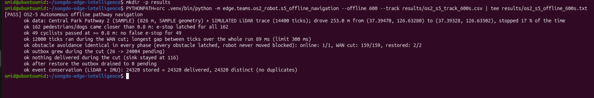

The OS2-5 route (`--track` CSV): left, the Central Park path (approximate SAMPLE geometry) with every
point where the e-stop latched; right, the first 60 s of LiDAR readings dipping under the 0.8 m line and
the e-stop latching each time. Sensor data is SIMULATED (seed 2026).

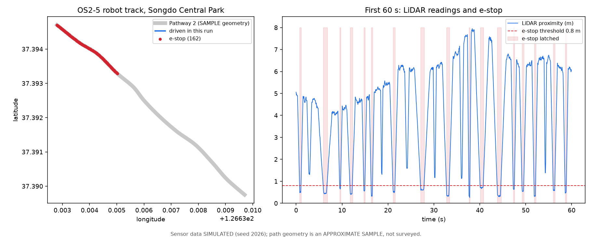

**OS3-5** — speed sign dispatch and event replay:

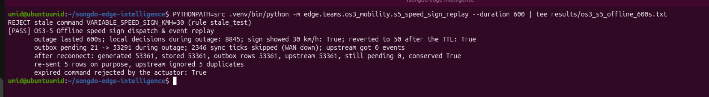

**OS4-5** — backlog drain and AirKorea benchmark (simulated 6 hours, runs in under a second). 180
readings queued during the cut, 360/360 acknowledged, 50 re-sent events answered `ACK_DUPLICATE`, hourly
means within 1.17 µg/m³ of the baseline (the baseline is SIMULATED until the real station-131233 file is added):

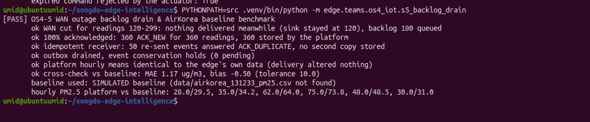

**OS5-5** — WAN cut and worker crash at the same moment, 10-minute outage:

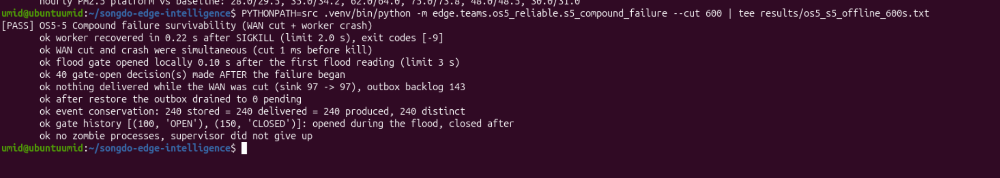

### 6. The live web console (README Step 5)
`bash scripts/start_demo.sh OS2`, then `http://127.0.0.1:8002`. All six processes are listed with their
PID, state, CPU %, RSS memory and voluntary/involuntary context switches, read live from `/proc`.

**Online:** 142 events, all delivered, outbox 0, *Conserved: yes*.

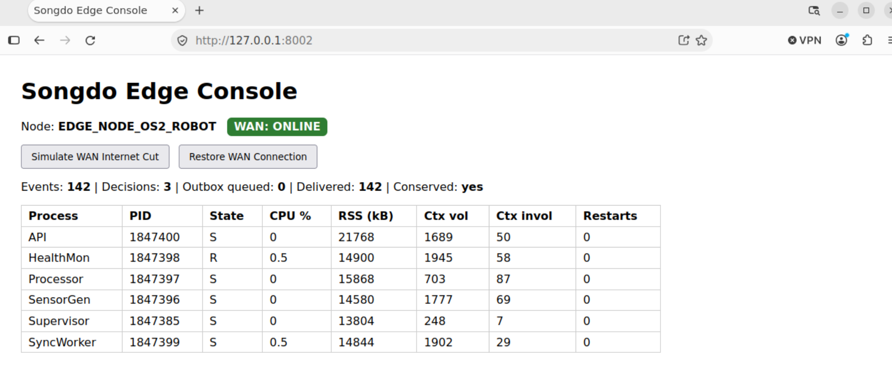

**After *Simulate WAN Internet Cut*:** the badge turns red (*WAN: OFFLINE (DISCONNECTED)*), events
(330) and local decisions (7) keep increasing, *Outbox queued* grows to 132, *Delivered* stays at 198,
and *Conserved* stays `yes` (330 = 198 delivered + 132 queued). No process restarted.

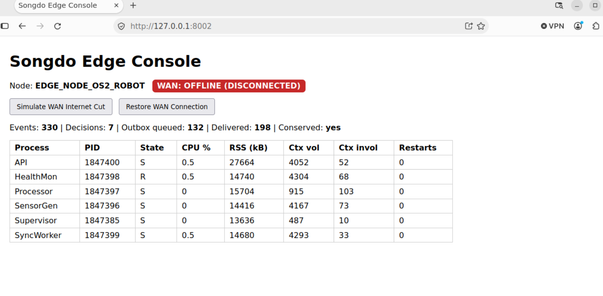

**After *Restore WAN Connection*:** the backlog drained — 386 events, 386 delivered, outbox 0,
*Conserved: yes*, still 0 restarts.

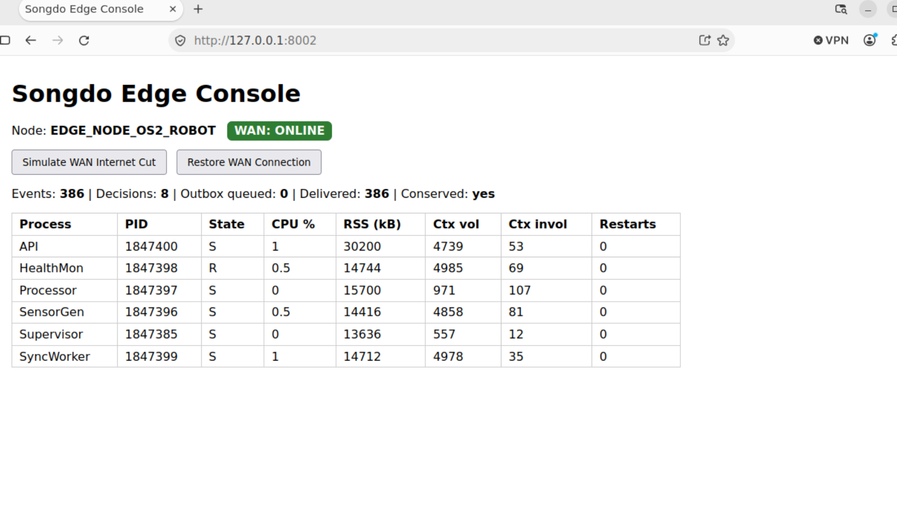

---

## File layout (as in the course README)

```
songdo-edge-intelligence/
├── config/
│   ├── node.yaml                  # master configuration (port 8000, data/songdo_edge.db)
│   └── os1.yaml ... os5.yaml      # one per theme (node id, sensors, rules, port, db)
├── container/
│   ├── Dockerfile                 # non-root Ubuntu 24.04 image, HEALTHCHECK
│   └── compose.yaml               # CPU/RAM cgroup limits + healthcheck
├── data/
│   ├── backups/                   # safe online SQLite backups
│   ├── songdo_edge.db             # created by scripts/setup.sh (not committed)
│   └── ...                        # cached open data + SAMPLE/SIMULATED files (see sources/)
├── docs/
│   ├── handbook/                  # where the handbook lives (see its README)
│   └── images/                    # the result screenshots shown above
├── integration/                   # mock upstream consumer + integration test
├── scenarios/
│   └── run_all_scenarios.py       # executable runner for all 25 scenarios
├── scripts/
│   ├── preflight.sh               # system environment audit
│   ├── setup.sh                   # environment initializer
│   ├── start_demo.sh              # multi-process supervisor and web launcher
│   ├── backup.sh                  # flocked online backup
│   └── generate_os2_sim_data.py   # OS2 SAMPLE path + SIMULATED LiDAR trace (seed 2026)
├── sources/
│   └── source_registry.csv        # Korean open data registry and what is REAL / SAMPLE / SIMULATED
├── sql/
│   └── schema.sql                 # SQLite DDL (WAL, events, decisions, outbox, sink, health)
├── src/
│   ├── edge/
│   │   ├── api_server.py          # zero-dependency local HTTP API server
│   │   ├── decision.py            # local rule engine, monotonic-clock command TTL
│   │   ├── ipc.py                 # BoundedQueue (500, drop_oldest), Unix socket, StopFlag
│   │   ├── models.py              # SensorEvent, EdgeDecision, ProcessHealth
│   │   ├── storage.py             # SQLite manager, atomic outbox, online backup
│   │   ├── supervisor.py          # multi-process supervisor (restart, clean shutdown)
│   │   ├── sync_worker.py         # durable offline outbox synchronizer
│   │   ├── workers.py             # SensorGen, Processor, HealthMon processes
│   │   ├── config.py, procfs.py   # config loader, /proc sampling
│   │   ├── core/                  # backward-compatibility alias for the old edge.core.* imports
│   │   └── teams/os1_building ... os5_reliable/   # one file per scenario (25)
│   └── ui/static/
│       └── index.html             # local edge console (no frameworks)
├── systemd/
│   ├── songdo-edge@.service       # user service, one instance per theme
│   └── songdo-backup@.service/.timer   # scheduled flocked backup
├── tests/
│   ├── test_os_fundamentals.py    # the five-check OS suite (Step 3)
│   ├── test_core.py, test_pipeline.py, test_configs.py
│   └── os1/ ... os5/              # scenario tests
├── requirements.txt
├── Songdo_Edge_Intelligence_Handbook.pdf   # instructor's PDF: copy it here locally (not in the public repo)
└── README.md
```

---

## Operations

**systemd (user service).** `%i` is the theme (`OS1` … `OS5`, or `node`):
```bash
mkdir -p ~/.config/systemd/user && cp systemd/songdo-edge@.service ~/.config/systemd/user/
systemctl --user daemon-reload && systemctl --user start songdo-edge@OS1.service
systemctl --user status songdo-edge@OS1.service
journalctl --user-unit songdo-edge@OS1.service -f -o short-iso
```
Burst limit 5 starts / 60 s, `Restart=on-failure`, `MemoryMax=512M`, `CPUQuota=50%`, `TasksMax=64`.

**Flocked backup:** `flock -n /tmp/songdo_backup.lock -c "./scripts/backup.sh"` (timer: `systemd/songdo-backup@.timer`).

**Container:**
```bash
docker build -f container/Dockerfile -t songdo-edge . && docker run --rm -p 8000:8000 songdo-edge
docker compose -f container/compose.yaml up --build      # 1 CPU, 512 MB, healthcheck
```

**Mock upstream:** `python3 integration/mock_upstream.py --port 9100` (POST /ingest, GET /stats; dedup by event_id).

**Inspecting the running node** (the handbook's command ladder):
```bash
pstree -p -a $(pgrep -f "python.*supervisor")               # process hierarchy
ps -p <PID> -o pid,ppid,user,%cpu,rss,time,stat,wchan:20    # one process
ss -xlp | grep songdo                                       # Unix domain sockets
vmstat 1 5                                                  # context switches, run queue
```

---

## Requirement map (handbook rubric → where it is)

| Rubric item | Where | Evidence |
|---|---|---|
| Multi-process roles (Sensor, Processor, Health, UI), bounded queues, sockets, zombie-free shutdown | `src/edge/supervisor.py`, `workers.py`, `ipc.py`; OS2-1, OS2-4 | Results §6 (6 processes), §3 |
| Race condition vs. Mutex, deadlock prevention, WAL durability, backup | `tests/test_os_fundamentals.py`; OS1-2, OS5-3, OS4-4 | Results §2 |
| Bash ladder, rule engine, monotonic command TTL | `scripts/*.sh`, `src/edge/decision.py`; OS1-3, OS2-3, OS4-3, OS5-4 | Results §1, §3 |
| systemd unit with burst limits + resource limits, flocked backups, container healthcheck | `systemd/`, `scripts/backup.sh`, `container/` | see Known gaps |
| 10-minute WAN disconnect, event conservation, idempotent receiver dedup | OS1-5 (`--outage 600`), OS2-5 (`--offline 600`), OS3-5 (`--duration 600`), OS5-5 (`--cut 600`), OS4-5; `integration/` | Results §5 |
| Zero-dependency dashboard with PIDs, CPU/RAM, outbox | `src/ui/static/index.html`, `src/edge/api_server.py` | Results §6 |
| Grounded data with honest labels | `sources/source_registry.csv` | — |

---

## Known gaps (be honest about them in the defense)
- **Data:** OS1-1 uses SAMPLE VWorld footprints, OS2-5 an APPROXIMATE Central Park path and a SIMULATED LiDAR trace, OS4-5 a SIMULATED AirKorea baseline, OS5-4 SIMULATED water levels. Details in `sources/source_registry.csv`.
- **Test platform:** the screenshots come from Ubuntu 26.04 / Python 3.14. On the handbook's Ubuntu 24.04 the five OS2 scenarios were run with Python 3.12 and the full suite with Python 3.13; there are no screenshots of those runs.
- **OS2-5 timing (fixed):** before the storage fix (PR #8: one cached SQLite connection per thread instead of a new one per write) the "longest gap between ticks < 300 ms" check failed on busy team machines (312–404 ms). After the fix: 137 ms on the test machine and **89 ms** on the team machine (Results §5).
- **ResourceWarning:** the unit tests print harmless `unclosed database` warnings on Python 3.14 (Results §2).
- **Container:** the Dockerfile and compose file have not been built on a team machine yet (only the node's container settings and the healthcheck command were tested).
- **systemd:** the unit's start command was tested; the unit itself has not yet been run under a real `systemctl --user`.
- The scenarios are separate programs; `start_demo.sh <theme>` runs the shared node, not the scenarios.
- **OS3:** the scripts `build_bus_stops.py` and `os3_live_demo.py` mentioned by the OS3 team are not in the repo.

## Git workflow
1. `main` always runs: never push broken code to it.
2. One branch per change, merged via pull request reviewed by someone else.
3. `git pull` from `main` often. Run the tests before every PR.
4. Everyone must be able to explain their own code: 20 points of the grade is an individual oral defense.
